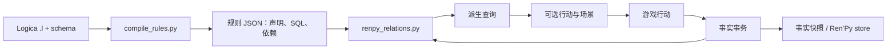

# 架构与实验取舍

Ren’Py Relations 将世界状态表示为事实，将资格与剧情前提表示为派生关系。规则回答“当前可以发生什么”，游戏脚本执行行动并记录结果。场景内部仍使用普通对白和选择；跨场景调度可以通过查询完成。

## 构建与运行的分界

`compile_rules.py` 使用真正的 Logica 编译器，为目标后端生成 SQL；运行时不解释 Logica，也不加载规则中的 Python 代码。每个导出关系独立编译，其他导出关系作为外部表保留引用，内部辅助谓词展开。这样不同查询可以共享派生关系。

`renpy_relations.py` 集中规则校验、事实事务、查询、快照、重载与 Ren’Py 绑定。SQLAlchemy Core 负责表定义和参数绑定；SQLite／DuckDB 的内部适配负责连接、冲突插入、读取验证、类型投影和原生镜像。

## 依赖与物化

SQLite authorizer、DuckDB 原生解析接口报告 SQL 直接读取的关系。构建产物保存依赖，运行时核验它与 SQL 一致；无依赖清单的规则集在加载时收集。依赖来自 SQL 解析，包含否定、空表、聚合和子查询，不取决于当时的数据分支。

直接边保存在私有 TEMP 表。数据库使用递归 CTE 执行循环检查、祖先排序、查询所需依赖和变更后的后继计算。Python 不实现 SQL 文本解析或依赖图遍历。祖先闭包在长链和稠密图上可能很昂贵，原生执行并不意味着加载成本很低。

三模式采用相同类型投影与过滤语义：live 使用 TEMP VIEW；cached 按需创建完整关系的 TEMP TABLE；materialized 提前计算全部派生表。查询不缓存过滤参数对应的 Python 结果。

事实变更按关系名传播失效，不分析行或参数值。通用状态表和共享全局条件可能扩大失效范围；这是 schema 与依赖模型的限制。派生表未配置业务字段索引，已物化关系上的过滤也可能扫描数据。

## 事务与候选世界

事实写入与 materialized 模式的受影响关系重建位于同一事务。失败同时回滚，重复断言和无匹配删除不改变缓存有效性。禁止事务内读取推导，避免观察半完成的行动。

恢复和规则重载先构建候选数据库，验证成功后交换当前世界。重载使用当前事实预执行新推导；失败保留旧事实、规则和缓存。事实 schema 是恢复与重载的兼容边界。

查询没有剧情副作用。奖励、消耗物品、剧情跳转等由游戏脚本执行，结果再写为事实。这使资格判断可以重复调用，也使剧情效果有明确的事务边界。

## 原生快照与历史

快照只保存事实与 `__rr_metadata` 中的格式、版本、后端和事实 schema 标识，不保存 TEMP 推导、缓存或依赖图。

| 后端路径 | 镜像生成与恢复 |
| --- | --- |
| 标准 SQLite | 优先 serialize／deserialize |
| SDK 的 pysqlite3 | 原生 backup，在内存库与私有临时文件间复制页 |
| DuckDB | 原生数据库复制，生成独立文件镜像 |

镜像为不可变字节串，未额外压缩；事实不变时复用。未绑定接收者的提交不生成镜像；绑定后每次有效提交发布完整镜像，发布失败恢复最后接受的状态。

Ren’Py store 保存镜像，启动、读档和回退回调恢复事实，再建立派生对象。完整镜像的时间与空间仍随事实量增长；数据库 checkpoint 或 MVCC 不能直接代替可独立保存的剧情历史。这里没有增量历史或存档迁移。

## 确定性与支持边界

规则应为确定性单条 SELECT。系统时钟、数据库随机数、外部文件与动态查询不属于规则输入；时间和随机结果由游戏写为事实。SQL 校验用于约束受信任的构建产物，不提供恶意 SQL 沙箱。

两后端共享游戏接口，SQL、函数与转换语义仍由各自数据库决定。运行时同步、单线程；DuckDB 连接也配置为单线程。跨派生关系的循环依赖拒绝加载，单个查询内部适用的递归 CTE 由后端执行。

运行环境与打包范围见 [RELEASE](RELEASE.md)，测量方法及当前数据见 [Benchmark](benchmarks/README.md)，接口契约见 [USAGE](USAGE.md)。
