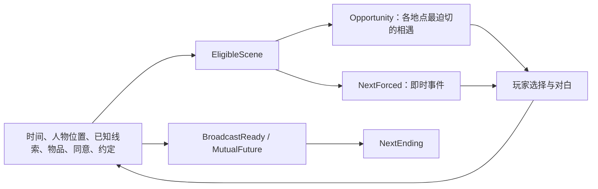

# 潮汐替我们保管

一个可直接试玩的中文 Galgame 短篇。约一万字、653 段对白／叙述（各分支总量），19 个事件、3 位成年女主角、5 个结局。单次游玩只会经历其中一部分事件。文字演出版，已有中文字体、场景配色、选择、手记、存读档与回退，未配立绘、音乐或配音。

岬湾旧电台将在午夜关停。沈川回来交还钥匙，却遇见一段被剪断的录音、三个各自准备告别的人，以及一场让渡船停航的雨。房子确实要交还；这一夜可以决定声音如何被带走，也可以重新约定人与人的下一次见面。

## 人物

| 人物 | 年龄 | 此刻的处境 |
| --- | --- | --- |
| 沈川 | 26 | 文案编辑，离乡两年；惯于把联系推到“以后”，今晚回来还钥匙 |
| 许澄 | 24 | 临时主播；父亲三年前病故，一直替别人守着他留下的声音 |
| 林遥 | 26 | 电工，明早去外地当学徒；正在学习接受帮助、拥有自己的时间 |
| 陆弥 | 25 | 声音创作者，获得异地驻留机会；想离开，也想让别人认识作品以外的自己 |

## 试玩

已构建的 Linux 发行包可解压后直接运行 `./tidelight.sh`，无需 SDK 或依赖安装。从源码创建独立试玩目录的最短流程见仓库 [QUICKSTART.md](../../QUICKSTART.md)。

从源码试玩时，`prepare_game.py` 会将运行时和匹配 SDK 的锁定依赖安装到独立游戏目录。默认 SQLite；包含两后端的目录可通过 `RELATIONS_BACKEND=duckdb` 切换。样例按后端隔离存档。

地图呈现此刻可以发生的相遇，人物会随时间移动。每次外出或长谈约二十分钟；停航、断电、传言等即时反应不额外消耗行动时间。到截止时进入最后一分钟，做完最终决定。随时可以查看手记、存档、读档和回退。开发模式下 F8 可查看编排关系；发行包关闭该界面。

## 剧情怎样编排

每个事件是一个局部完整的场景，演出后返回统一调度器。调度器读取 `NextForced`、`Opportunity` 与 `NextEnding`，不在场景结尾指定下一个场景。



- `Here` 根据时间与人物行程计算位置。
- `Trust` 汇总具体相处行为的记录。它决定某些谈话能否发生；恋爱结局还需要明确的双方约定。
- `NeedKnowledge / NeedItem / NeedConsent / NeedChoice / NeedBond` 描述事件的世界条件。
- `EligibleScene` 检查这些条件与场景窗口、人物所在位置，排除已经发生的事件。
- `NextForced` 处理当下最迫切的即时事件；`Opportunity` 在每个地点选出当前最重要的话题。
- `AvailableAction` 进一步检查选择条件，例如只向身边的人递茶、供电正常时播放录音、广播准备齐备时公开播出。
- `BroadcastReady` 合并设备、母带、来源辨识和相关人物的同意。
- `MutualFuture` 表示已经明确答应彼此的下一次见面；`NextEnding` 综合这些关系和最终决定选出结局。

常规事件没有“必须先看上一段”的条件。`Seen` 只防止重复播放，不作为后续场景的解锁要求。具体例子：

1. 配电图既可从林遥的工具箱谈话取得，也可从电台工作簿取得，因此借保险可以发生在看车票之前。
2. 工作簿能解释录音来源；获得这条线索后，可以直接与许澄深谈，稍后再听那段被剪断的片段。
3. 如果先做其他事，停航后的陆弥谈话可能先于借出登记；她不必等玩家完成一段“初遇”。
4. 单方播放或取走录音会产生传言反应；它来自选择造成的事实变化。
5. 修复线路不等于获得播出许可；最后可以公开播出、留在屋内，或安静结束。

场景内部保留正常的线性对白与选择；关系查询负责跨场景的开放、位置、优先级、即时反应和结局。

## 文件

- [完整剧本](game/story.rpy)：序章、19 个事件、等待片段及五个结局正文。
- [界面与调度器](game/script.rpy)：地图、手记、存读档、编排观察与查询分派。
- [规则](world.l)：由 Logica 编译的关系推导。
- [剧情事实与选择效果](game/content.json)：事件资料、人物行程、前提与行动结果。
- [行动适配](game/night.py)：把选择结果、事件完成和时间变化放在同一事务中，不自行决定剧情资格。
- [试玩路线与编排示例](ROUTES.md)：包含结局剧透。

## 修改与验证

以下命令从源码仓库根目录执行。编译或修改正文后，重新生成独立试玩目录再进行引擎检查。

重新编译两个后端：

```sh
uv run --locked python compile_rules.py examples/tidelight/world.l \
  --schema examples/tidelight/schema.json --output examples/tidelight/game/relations.rules.json
uv run --locked --extra duckdb python compile_rules.py examples/tidelight/world.l \
  --schema examples/tidelight/schema.json --backend duckdb \
  --output examples/tidelight/game/relations.duckdb.rules.json
```

字库为 Noto Sans CJK SC 的改名子集，许可证与来源见 [字体说明](game/fonts/README.md)。修改中文文案后，可用本机完整字体重建：

```sh
uv run --locked --group assets python examples/tidelight/build_font.py \
  --source-font /usr/share/fonts/noto-cjk/NotoSansCJK-Regular.ttc
```

验证关系编排；引擎检查使用按上手说明生成的独立目录 `/tmp/my-tidelight`：

```sh
uv run --locked --extra duckdb --group renpy-linux --group assets pytest tests/test_tidelight.py
uv run --locked --extra duckdb python check_renpy.py --sdk /path/to/renpy-sdk \
  --game /tmp/my-tidelight --headless --backend sqlite --timeout 180
```

Python 检查覆盖两后端三模式、五结局路线、场景重排、授权条件、快照分支和随机合法游玩样本。引擎测试实际点击结局路线，并检查存读档、回退、手记和开发观察界面。测试用例是行为检查，不保证所有可能的探索顺序。

这是仓库内的实验样例。分发独立游戏时，还需将根目录的 `renpy_relations.py` 放入其实际 `game/python-packages`，并将规则、剧情 JSON 与原生扩展作为实际文件保留；不要将这些由 Path／原生驱动读取的文件只放进资源归档。

本项目剧本与代码采用 MIT。发行包还包含 Ren’Py 及其原生组件，其中部分组件使用 LGPL；完整第三方清单与源码入口见 [Ren’Py 许可说明](https://www.renpy.org/doc/html/license.html)，完整声明随发行包 `LICENSE.txt` 保留。字体继续使用 OFL。
